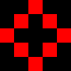
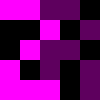
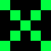
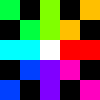

# ZOOZOO88 — 주주클럽

STARLIT_VIT6에서 즐기는 8×8 구슬 맞추기 게임입니다. 이웃한 구슬을 바꿔 같은 색을 가로나 세로로 3개 이상 연결하고, 제한시간 안에 목표 개수를 제거하세요!

## 실행

배포된 `.sbc` 게임 파일을 STARLIT_VIT6에서 실행하세요. 시작 도움말에서 아무 버튼이나 누르면 1레벨이 시작됩니다. `res`의 이미지는 이 설명서용이며 게임 실행에는 필요하지 않습니다.

## 조작법

| 버튼 | 기능 |
| --- | --- |
| `2` / `4` / `6` / `8` | 커서를 위 / 왼쪽 / 오른쪽 / 아래로 이동 |
| `5` | 구슬 선택. 선택한 뒤 방향 버튼을 한 번 누르면 해당 이웃과 즉시 교환 |
| `5` (선택한 같은 칸에서 다시 누르기) | 선택 취소 |
| `5` (폭탄 위에서) | 폭탄 즉시 발동 |
| `0` | 선택 취소 |
| `F1` | 힌트 : 가능한 교환 또는 사용 가능한 폭탄을 청록색 테두리로 깜빡임. |
| `*` | 도움말 보기. 아무 버튼으로 게임 화면에 복귀 |
| `#` | 점수와 레벨을 초기화하고 새 게임 시작 |
| `F5` | 게임 종료 |

예를 들어 구슬 위에서 `5`를 누른 뒤 `6`을 누르면 오른쪽 구슬과 교환합니다. 매치가 생기지 않는 일반 구슬 교환은 원래대로 돌아옵니다. 보드 가장자리 밖으로는 이동하거나 교환할 수 없습니다.

흰색 테두리는 현재 커서, 주황색 테두리는 선택한 칸입니다. 조작 버튼의 LED도 평소에는 보라색, 선택 중에는 주황색으로 표시됩니다.

## 기본 규칙과 연쇄

- 같은 색 구슬을 가로나 세로로 3개 이상 연결하면 제거됩니다. 대각선 연결은 일반 매치로 인정되지 않습니다.
- 빈자리 위의 구슬이 내려오고 새 구슬이 보충됩니다. 다시 매치가 생기면 자동으로 연쇄가 이어집니다.
- 제거한 칸마다 기본 10점을 얻고, 같은 행동에서 이어지는 연쇄는 2배, 3배…로 점수가 증가합니다. 폭탄 사용 뒤 생긴 첫 매치는 2배부터 시작합니다.
- 폭탄 자체도 제거 점수를 주지만, 목표 달성과 시간 보너스는 **일반 구슬**을 제거했을 때만 적용됩니다. 점수는 최대 99,999점입니다.
- 가능한 교환도 폭탄도 없으면 점수를 유지한 채 보드가 자동으로 다시 구성됩니다.

## 레벨과 제한시간

일반 구슬을 하나 제거할 때마다 제한 시간이 늘어납니다. 폭탄으로 제거한 구슬과 연쇄로 제거한 구슬에도 같은 시간 보너스가 적용됩니다.

| 레벨 | 제거 목표 | 일반 구슬 색상 수 |
| --- | ---: | ---: |
| 1~6 | 40개~65개, 매 단계마다 5개씩 증가 | 6색 |
| 7~ | 70개~, 매 단계마다 10개씩 증가 | 7색 |

목표를 채우면 현재 행동의 연쇄가 끝난 뒤 다음 레벨로 넘어갑니다. 점수는 유지되고 보드는 새로 만들어지며, 목표를 초과한 제거 개수와 남은 시간은 이월되지 않습니다.

제거·낙하·폭발과 레벨 전환 연출 중에는 카운트다운이 멈춥니다. **게임 중 도움말과 F1 힌트를 보는 동안에는 시간이 계속 흐릅니다.** 시간이 다 되면 게임이 끝나고 최종 레벨과 점수가 표시됩니다.

## 화면 읽기

왼쪽은 게임 보드, 오른쪽은 진행 상태입니다.

| 표시 | 의미 |
| --- | --- |
| `L` | 현재 레벨 |
| `T:` | 남은 시간(초) |
| `LEFT` | 다음 레벨까지 더 제거해야 하는 일반 구슬 수 |
| `SCORE` | 누적 점수 |

## 폭탄 7종

폭탄은 보드에 최대 하나만 존재합니다. 일정 확률로 나타나며, 4개나 5개를 맞춘다고 폭탄이 만들어지지는 않습니다.

폭탄에 커서를 옮겨 `5`를 누르면 바로 발동합니다. 일반 구슬을 선택한 뒤 이웃 폭탄 쪽으로 교환해도, 폭탄이 옮겨진 자리에서 발동합니다. 방향 폭탄의 제거 범위는 폭탄 위치를 기준으로 보드 끝까지 이어집니다.

| 아이콘 | 이름 | 효과 |
| :---: | --- | --- |
|  | 좌우 폭탄 | 같은 행 전체 제거 |
|  | 상하 폭탄 | 같은 열 전체 제거 |
|  | 상하좌우 폭탄 | 같은 행과 열을 십자 모양으로 제거 |
|  | 랜덤 폭탄 1 | 현재 보드에 있는 일반 구슬 색상 중 하나를 무작위로 골라 해당 색상을 모두 제거 |
|  | 랜덤 폭탄 2 | 현재 보드의 서로 다른 두 색상을 무작위로 골라 모두 제거. 한 색상만 남았다면 그 색상만 제거 |
|  | 대각선 폭탄 | 네 대각선 방향을 X 모양으로 제거 |
|  | 8방 폭탄 | 상하좌우와 네 대각선, 총 여덟 방향 제거 |

폭탄으로 생긴 빈자리도 자동으로 보충되고, 이후 매치는 연쇄로 이어집니다. ~~막혔다면 `F1`으로 힌트를 확인하거나 폭탄을 활용해 보세요~~.
